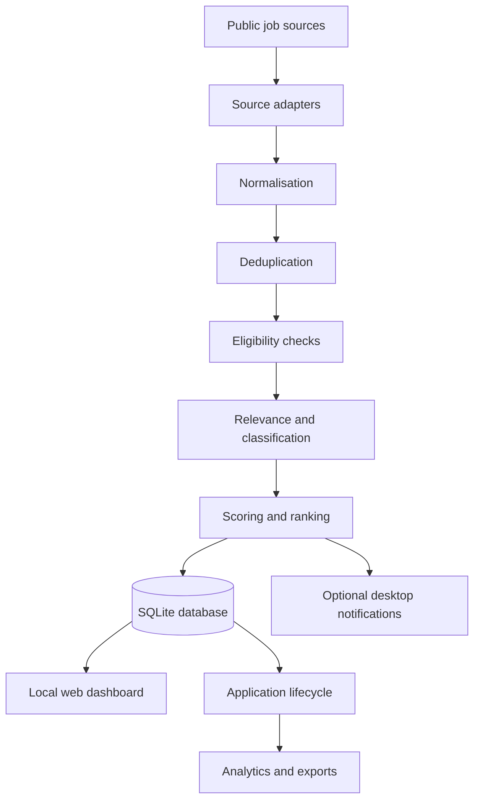

# Job Intelligence & Application Tracker

A local-first application that collects job opportunities from multiple public job sources, evaluates them against configurable candidate criteria, ranks opportunities, and manages the application lifecycle from discovery through follow-up.

**Built to solve a real workflow problem:** reduce repetitive job-board searching and make it easier to focus on opportunities that are relevant, actionable, and worth reviewing.

## Project overview

The application evolved from a simple job-feed collector into a local job-intelligence and application-management tool. It combines:

- Multi-source job ingestion
- Normalisation and cross-source deduplication
- Candidate-profile-based relevance scoring
- Geographic eligibility checks
- Opportunity classification and priority ranking
- A local web dashboard
- Application tracking and status history
- Search activity analytics and spreadsheet export
- Scheduled execution and desktop notifications on supported systems

The system is designed to assist decision-making, not to submit job applications automatically. Users retain control over which opportunities they pursue.

## Architecture



### Main components

| Component | Responsibility |
|---|---|
| Ingestion adapters | Retrieve listings from supported public APIs and feeds |
| Normalisation | Convert source-specific records into a common job model |
| Deduplication | Detect repeated listings across sources |
| Eligibility evaluation | Assess location and work-eligibility signals in job descriptions |
| Scoring and ranking | Compare job requirements with configurable candidate profiles |
| SQLite persistence | Store jobs, application records, and status history |
| Dashboard | Browse, search, filter, and prioritise opportunities |
| Application tracking | Record application stages, notes, and follow-up actions |
| Analytics and export | Summarise activity and export reviewable records |

## Technology

- **Python** — application logic, ingestion pipeline, scoring, scheduling
- **SQLite** — local persistence
- **HTML, CSS and vanilla JavaScript** — dashboard interface
- **HTTP APIs and RSS/Atom** — job-source integrations
- **pytest** — automated tests
- **openpyxl** — spreadsheet exports
- **macOS native notifications** — optional desktop notifications

## Selected engineering decisions

### Local-first by design
SQLite and a lightweight local server provide a useful personal application without requiring a cloud service, distributed infrastructure, or a hosted database.

### Separate job discovery from application state
A discovered listing is not automatically an application. Job records and application records have distinct lifecycles, so a user can review or dismiss a job without creating an application.

### Preserve application history
Status transitions are recorded so that activity and funnel metrics can be derived from changes over time rather than only the current status.

### Treat geographic eligibility as part of relevance
A strong technical match is not necessarily actionable when an employer restricts hiring to specific countries. The system evaluates location signals alongside technical relevance.

### Human-controlled decisions
The application supports discovery, evaluation, prioritisation, and tracking. It does not automatically submit applications or attempt to bypass platform access controls.

## Repository structure

```text
src/job_monitor/
  ingestion/       Source adapters, parsing, normalisation, deduplication
  scoring/         Candidate matching, eligibility, classification, ranking
  db/              SQLite schema and persistence
  dashboard/       Local dashboard server and interface
  models/          Domain models
  reports/         Analytics and export
  scheduler/       Scheduled-run support
  notifications/   Optional desktop notifications
tests/             Automated test suite
docs/              Development and release documentation
```

## Running locally

Requirements: Python 3.9 or later.

```bash
git clone https://github.com/chikodiann/job-intelligence-tracker-showcase.git
cd job-intelligence-tracker-showcase

python3 -m venv .venv
source .venv/bin/activate

pip install -e ".[dev]"
cp config.example.yaml config.yaml
# profiles/example.yaml is an illustrative profile; edit it for your own criteria.
job-monitor --profile example dashboard
```

Then open `http://127.0.0.1:8500`.

Run the ingestion pipeline:

```bash
job-monitor --profile example run
```

Run the tests:

```bash
pytest
```

Some scheduling and desktop-notification features are platform-specific. Review the relevant implementation and documentation before enabling them on another operating system.

## Configuration and privacy

Candidate profiles, local databases, environment files, runtime state, and machine-specific scheduler configuration are not included in this showcase repository. Configure the application locally using the documented defaults and your own private configuration.

Do not commit API credentials, personal data, database exports, or machine-specific paths.

## About the project

This project was developed to solve a practical problem encountered during an active job search. It was built iteratively: each new capability addressed a bottleneck discovered while using the previous version.

The most meaningful part of the work is the end-to-end ownership involved: identifying the problem, shaping the data model, integrating multiple sources, building the pipeline and dashboard, adding tracking and analytics, and improving reliability through testing.

## Author

**Chikodinaka Ann Anyanwu**  
GitHub: [@chikodiann](https://github.com/chikodiann)

---
*This public repository is a portfolio showcase. It intentionally excludes private user profiles, local data, personal configuration, and machine-specific files.*
